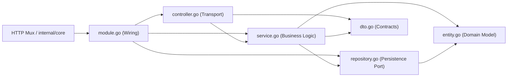

# Architecture Guide

This repository follows a **layered modular monolith** architecture. Every business domain lives in an isolated module with strict, unidirectional dependencies enforced automatically by `TestArchitectureModularLayerBoundaries`.

## Dependency Direction



## Module Structure (`internal/modules/<domain>/`)

Every domain module is organized into six single-purpose files (each capped at 500 lines):

1. **`entity.go`**: Pure domain structs and invariants. Must never reference `dto`, `Repository`, `Service`, or `Controller`.
2. **`dto.go`**: Request/response structs and boundary validation (`ValidateAddRequest`). Must never reference `Repository`, `Service`, or `Controller`.
3. **`repository.go`**: Persistence interface (`Repository`) and storage adapters (`InMemoryRepository`). Uses only `entity.go`.
4. **`service.go`**: Core business rules and orchestration. Coordinates `dto.go`, `entity.go`, and `repository.go`. Must never reference `Controller`.
5. **`controller.go`**: Transport adapter (HTTP, CLI, RPC). Accepts raw inputs, invokes `Service`, and returns `dto.go`. **Forbidden** from referencing `Repository` directly.
6. **`module.go`**: Composition root (`NewModule()`) that wires `InMemoryRepository` into `Service` and `Controller`.

## Reference Example: `modules/math`

The included `internal/modules/math/` module demonstrates this pattern with an addition service exposed via `GET /math/add` that validates operand bounds and records calculation history.

## Adding a New Domain Module

1. Create `internal/modules/<domain>/` with the six standard files (`entity.go`, `dto.go`, `repository.go`, `service.go`, `controller.go`, `module.go`).
2. Wire the module into `internal/core/core.go`.
3. Add unit, integration, and layer boundary tests in `internal/core/core_test.go`.
4. Run `go run ./cmd/xtask validate` to verify all eight gates pass.

## Strict AST Policy & Tripwires

- **AST Guardrails**: `cmd/xtask/lint.go` enforces `go vet ./...` plus native `go/ast` checks across `internal/` forbidding `"unsafe"`, dot imports, `init()`, `panic()`, `fmt.Print*`, `os.Exit`, `log.Fatal*`, `time.Sleep`, `context.Background`/`TODO`, `interface{}`, mutable package vars, boolean flag parameters, and unjustified `//nolint`, while requiring doc comments on exported symbols.
- **Race & Policy Lock**: `cmd/xtask/main.go` runs tests with `-race`, and `internal/core/core_test.go` fails if any AST rule, `-race` flag, or 3-day cooldown setting is removed.

## Monorepo Variant Architecture

When scaling into multiple Go services and shared libraries, adopt the `go.work` multi-module workspace layout:

```text
.
├── apps/                         # Independently deployable services
│   ├── server/                   # Backend daemon with go.mod
│   └── cli/                      # CLI tool with go.mod
├── packages/                     # Shared internal modules
│   ├── core/                     # Pure domain logic and models with go.mod
│   └── contract/                 # Shared RPC/REST interfaces with go.mod
├── cmd/xtask/                    # Sovereign workspace validation engine
└── go.work                       # Workspace manifest: use ( ./apps/... ./packages/... )
```

- **Workspace Orchestration**: Go multi-module workspaces coordinate shared code locally without modifying `go.mod` files or publishing intermediate packages.
- **Validation Parity**: `go run ./cmd/xtask validate` iterates all modules and ensures uniform hygiene, cooldown, and unit tests.
